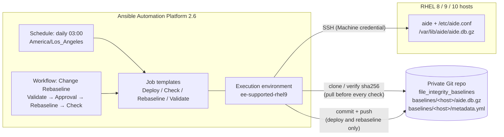

# file_integrity: AIDE File Integrity Monitoring for Ansible Automation Platform

[](https://github.com/mlowcher61/file_integrity/actions/workflows/lint.yml)

This project uses **Ansible Automation Platform (AAP) 2.6** to deploy and run
[AIDE](https://aide.github.io) (Advanced Intrusion Detection Environment) on
RHEL 8, 9 and 10. AIDE takes a fingerprint (a "baseline") of important
files such as binaries, configuration, boot files and SSH keys. Later it
reports anything that was **added, removed or changed**.

On its own, AIDE keeps the baseline on the server it protects, so an attacker
who controls that server can quietly rebuild the baseline and hide their
changes. This project stores the **known-good baseline off the host**, in a
private Git repository. Before every check, AAP restores that trusted
baseline onto the host and verifies its SHA-256 hash.

It wraps the Red Hat certified **`redhat.rhel_system_roles.aide`** role. There
is no custom AIDE role.

---

## Contents

- [How it works](#how-it-works)
- [What you get](#what-you-get)
- [Prerequisites](#prerequisites)
- [Deploy to AAP (from AAP)](#deploy-to-aap-from-aap)
- [Day-to-day use](#day-to-day-use)
- [Variable reference](#variable-reference)
- [Repository layout](#repository-layout)
- [Testing and CI](#testing-and-ci)
- [Testing outside AAP (optional)](#testing-outside-aap-optional)
- [Further documentation](#further-documentation)

---

## How it works



| Step | Deploy | Check | Rebaseline |
|------|:------:|:-----:|:----------:|
| Install AIDE and render `/etc/aide.conf` from Ansible variables | ✅ | ✅ (also detects and corrects config drift) | ✅ |
| Pull the baseline from the Git repo and verify its sha256 | ✅ (to see if one exists) | ✅ | ✅ |
| `aide --init`, fetch the DB, **push** it to the Git repo | ✅ (only hosts without a baseline) | ❌ never | ❌ |
| Restore the trusted baseline onto the host, then `aide --check` | | ✅ | |
| `aide --update` against the trusted baseline, **push** with change ref | | | ✅ (requires `aide_change_ref`) |

## What you get

- **4 playbooks:** `aide_deploy.yml`, `aide_check.yml`, `aide_rebaseline.yml`,
  `aide_config_validate.yml`.
- **A data-driven `aide.conf`.** You manage the watch list with Ansible
  variables, globally or per group or host (see [docs/WATCHLIST.md](docs/WATCHLIST.md)).
- **SHA-512 only (FIPS-appropriate).** Pre-flight checks reject md5, sha1
  and other non-FIPS hashes.
- **Readable reports.** Each check prints a per-host summary in the job
  output and publishes structured results with `set_stats`, so workflows or
  Event-Driven Ansible can act on them.
- **AAP configuration as code** (`aap/`), run **from AAP** by the
  *AIDE - Configure AAP* job template. It creates the credential type,
  credential, execution environment, project, 4 job templates, the approval
  workflow and the daily schedule, and keeps its own job template in sync.
  Every object that supports labels gets the `file_integrity` label.
- **AAP-only scheduling.** The AAP scheduler runs the daily check. No cron
  jobs are created on hosts, and any existing AIDE cron entry is removed.
- **CI** (GitHub Actions). Runs yamllint, ansible-lint (production profile),
  syntax checks, a template render test and a report parser test.

## Prerequisites

| What | Why |
|------|-----|
| AAP 2.6 (controller + gateway) | Runs the job templates. |
| `ee-supported-rhel9` execution environment | Already contains `redhat.rhel_system_roles`. No custom EE is needed. The git backend also needs the `git` CLI in the EE; the playbooks check for it first and fail with a clear message if it is missing. |
| RHEL 8, 9 or 10 hosts in an AAP inventory group named `aide` (or set `aide_target_hosts`) | The systems to protect. |
| A Machine credential (SSH user with sudo) | Lets AAP connect to the hosts and become root. |
| A **private** Git repository for baselines, with at least one commit (e.g. a README) | Off-host, tamper-evident baseline store. Default: `github.com/mlowcher61/file_integrity_baselines`. |
| A token with **read/write** access to that repository | GitHub fine-grained token (Contents: Read and write) or GitLab project access token (`write_repository`). It is stored only in an AAP credential. |
| Red Hat Automation Hub access on the AAP organization | AAP installs the certified and validated collections below when the project syncs. |

Collections (`collections/requirements.yml`, installed by AAP at project sync):

- `redhat.rhel_system_roles` (certified; already in `ee-supported-rhel9`)
- `ansible.posix` (certified)
- `community.general` (listed for parity; not currently used by the playbooks)
- `infra.aap_configuration` (validated), `ansible.platform` and `ansible.controller` (certified): used only by the *AIDE - Configure AAP* job template

## Deploy to AAP (from AAP)

Everything is set up from the AAP web UI. You create three objects by hand,
and a config-as-code job template creates the rest. The full walkthrough,
with every field to fill in, is in **[aap/README.md](aap/README.md)**:

1. Give your organization Automation Hub access (Galaxy credentials).
2. Create a **Red Hat Ansible Automation Platform** credential, so AAP can configure itself.
3. Create the **`file_integrity`** project from this repository.
4. Create the **`AIDE - Configure AAP`** job template (`aap/configure_aap.yml`),
   with four extra variables (organization, inventory, machine credential, AAP
   credential) and a password survey for the baseline repository token.
5. Launch it. It creates the credential type and credential, the EE, the
   job templates, the approval workflow and the daily schedule.
6. Launch **AIDE - Validate Config**, **AIDE - Deploy**, then **AIDE - Check**.

From then on, **AIDE - Check** runs every day at 03:00 (America/Los_Angeles)
from the AAP scheduler. No cron jobs are used on the hosts.

## Day-to-day use

| Job template / workflow | When to use it | Changes hosts? | Changes the baseline repo? |
|---|---|---|---|
| **AIDE - Validate Config** | Before deploying a watch list change. Renders `aide.conf` to a temp file and runs `aide --config-check`. | No | No |
| **AIDE - Deploy** | First rollout and when adding new hosts. Safe to re-run: existing baselines are kept unless `aide_force_init=true`. | Yes | Only for hosts without a baseline |
| **AIDE - Check** | Daily (scheduled) or on demand. Fails hosts with changes (`aide_fail_on_change`). | Restores the trusted DB and enforces config | **Never** |
| **AIDE - Rebaseline** | After an **approved** change. The survey asks for the change reference; use Limit for one host. | Yes | Yes (records the change ref) |
| **AIDE - Change Rebaseline** (workflow) | The recommended way to rebaseline: Validate → **approval** → Rebaseline → Check. | Yes | Yes |

Runbooks for every scenario, including triaging an alert, adding hosts and
recovering a corrupt baseline, are in [docs/OPERATIONS.md](docs/OPERATIONS.md).

## Variable reference

All defaults live in
[`playbooks/roles/file_integrity_defaults/defaults/main.yml`](playbooks/roles/file_integrity_defaults/defaults/main.yml)
(lowest precedence). Override any of them in an AAP inventory, group or host,
in job template extra vars, or in `inventory/group_vars/` for local runs.

| Variable | Default | Description |
|---|---|---|
| `aide_target_hosts` | `aide` | Inventory group or pattern the plays target. |
| `aide_supported_distributions` | `[RedHat]` | Distributions that pass pre-flight. |
| `aide_supported_major_versions` | `["8", "9", "10"]` | RHEL major versions that pass pre-flight. |
| `aide_db_dir` | `/var/lib/aide` | AIDE database directory. Must stay `/var/lib/aide` (the system role hardcodes it). |
| `aide_log_dir` | `/var/log/aide` | AIDE report log directory. |
| `aide_rule_groups` | `CONTENTEX`, `PERMS`, `LOG` | Named attribute sets. Names must be alphanumeric. |
| `aide_watch_paths` | `/boot`, `/etc`, `/usr/bin`, `/usr/sbin`, `/usr/lib`, `/usr/lib64`, `/root/.ssh`, `/var/log` | Baseline watch list (`{path, rule}`). |
| `aide_watch_paths_extra` | `[]` | Group- or host-level additions, merged in and de-duplicated by path (later wins). |
| `aide_exclude_paths` | `/etc/mtab`, `/etc/.*~`, `/var/log/journal`, `/var/lib/aide`, `/var/log/aide` | Paths AIDE ignores. |
| `aide_exclude_paths_extra` | `[]` | Group- or host-level additional exclusions. |
| `aide_forbidden_hashes` | md5, sha1, rmd160, tiger, crc32, crc32b, haval, gost, whirlpool | Hashes that pre-flight rejects. |
| `aide_fail_on_change` | `true` | Fail hosts with any added, removed or changed entry, after all hosts are reported. |
| `aide_report_max_paths` | `200` | Maximum paths listed per host in output and `set_stats`. |
| `aide_command_timeout` | `3600` | Seconds an `aide` run may take. |
| `aide_force_init` | `false` | Deploy: replace existing baselines. |
| `aide_change_ref` | `""` | Rebaseline: required change reference (e.g. `CHG0012345`). |
| `aide_change_ref_pattern` | `^[A-Za-z0-9][A-Za-z0-9._:/-]*$` | Allowed format for `aide_change_ref`. |
| `aide_baseline_backend` | `git` | Baseline store backend (only `git` is implemented). |
| `aide_baseline_repo_url` | `https://github.com/mlowcher61/file_integrity_baselines.git` | Baseline repository (HTTPS for tokens; `file://` works for testing). |
| `aide_baseline_repo_branch` | `main` | Branch for baselines. |
| `aide_baseline_path_prefix` | `baselines` | Directory in the repo that holds `<host>/` folders. |
| `aide_baseline_git_username` | `oauth2` | HTTPS username sent with the token. |
| `aide_baseline_git_token` | env `AIDE_BASELINE_GIT_TOKEN` | Injected by the *AIDE Baseline Git Token* credential. Never commit it. |
| `aide_baseline_git_author_name` / `_email` | `AAP file_integrity` / `file-integrity@localhost` | Commit author for baseline commits. |

Results published with `set_stats` (available to workflow nodes and EDA):

| Key | Published by | Contents |
|---|---|---|
| `aide_check_results` | Check | `{host: {status, added, removed, changed, added_paths, removed_paths, changed_paths, paths_total, paths_truncated, baseline_sha256, config_drift_corrected, ...}}` |
| `aide_hosts_with_changes` | Check, Rebaseline | List of hosts with differences. |
| `aide_rebaseline_results` | Rebaseline | Same shape as `aide_check_results`; the changes that were accepted. |
| `aide_config_validation` | Validate | `{host: {valid, deploy_would_change_config, aide_version}}` |

## Repository layout

```
file_integrity/
├── README.md                     ← you are here
├── ansible.cfg / ansible-navigator.yml
├── collections/requirements.yml  ← installed by AAP at project sync
├── inventory/                    ← example inventory + group_vars for local runs
├── playbooks/
│   ├── aide_deploy.yml  aide_check.yml  aide_rebaseline.yml  aide_config_validate.yml
│   ├── roles/file_integrity_defaults/   ← all default variables (no tasks)
│   ├── tasks/                    ← preflight, baseline_pull/push/restore, report
│   │   └── backends/git/         ← git implementation of the baseline store
│   └── templates/aide.conf.j2
├── aap/                          ← AAP configuration as code (infra.aap_configuration)
├── docs/                         ← DESIGN, OPERATIONS, WATCHLIST
├── tests/                        ← render test, report parser test, AIDE output fixtures
└── .github/workflows/lint.yml
```

## Testing and CI

Run the same checks as CI locally:

```bash
pip install ansible-core ansible-lint yamllint
ansible-galaxy collection install -r collections/requirements.yml -p collections
yamllint --strict .
ansible-lint --profile production
for p in playbooks/*.yml tests/test_*.yml; do ansible-playbook --syntax-check "$p"; done
ansible-playbook tests/test_render.yml     # renders aide.conf.j2, checks duplicates, rules, hashes
ansible-playbook tests/test_report.yml     # parses real AIDE 0.16 / 0.19 output fixtures
```

`pre-commit install` enables the same linters, plus gitleaks secret scanning,
on every commit.

The playbooks were tested end to end (deploy, idempotent re-deploy, check,
tamper detection, hash-mismatch and missing-baseline failures, rebaseline)
against RHEL-compatible Rocky Linux 8 (AIDE 0.16), 9 and 10
(AIDE 0.19) with ansible-core 2.16 and 2.21.

## Testing outside AAP (optional)

The solution is designed to run in AAP. For development or a quick lab test,
you can run the playbooks from a workstation with `ansible-navigator`, using the
same `ee-supported-rhel9` execution environment (`ansible-navigator.yml`):

```bash
podman login registry.redhat.io
export AIDE_BASELINE_GIT_TOKEN='github_pat_...'      # never put it in a file in git
# Edit inventory/example.yml (group "aide") and inventory/group_vars/ as needed
ansible-navigator run playbooks/aide_config_validate.yml -i inventory/example.yml
ansible-navigator run playbooks/aide_deploy.yml          -i inventory/example.yml
ansible-navigator run playbooks/aide_check.yml           -i inventory/example.yml
```

Scheduling, approvals, surveys and notifications only exist in AAP.

## Further documentation

- [docs/DESIGN.md](docs/DESIGN.md): architecture, baseline trust model, decisions, deviations from the spec
- [docs/OPERATIONS.md](docs/OPERATIONS.md): runbooks (deploy, daily check, triage, rebaseline, add host, recovery)
- [docs/WATCHLIST.md](docs/WATCHLIST.md): adding and removing paths, rule groups, common exclusions
- [aap/README.md](aap/README.md): step-by-step deployment to AAP, from AAP
- [CHANGELOG.md](CHANGELOG.md)

## License

MIT. See [LICENSE](LICENSE).
