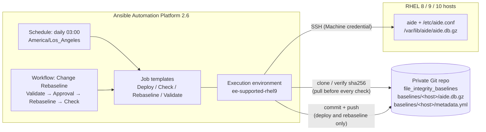

# file_integrity: AIDE File Integrity Monitoring for Ansible Automation Platform

[](https://github.com/mlowcher61/file_integrity/actions/workflows/lint.yml)

This project uses **Ansible Automation Platform (AAP) 2.6** to deploy and run
[AIDE](https://aide.github.io) (Advanced Intrusion Detection Environment) on
RHEL 8, 9 and 10. AIDE takes a fingerprint (a "baseline") of important
files such as binaries, configuration, boot files and SSH keys. Later it
reports anything that was **added, removed or changed**.

On its own, AIDE keeps the baseline on the server it protects, so an attacker
who controls that server can quietly rebuild the baseline and hide their
changes. This project stores the **known-good baseline off the host**, in a
private Git repository. Before every check, AAP restores that trusted
baseline onto the host and verifies its SHA-256 hash.

It wraps the Red Hat certified **`redhat.rhel_system_roles.aide`** role. There
is no custom AIDE role.

> **More detail:** this README is the overview. The [`docs/`](docs/) folder has
> the in-depth guides:
> [WATCHLIST.md](docs/WATCHLIST.md) (what is monitored and how to change it),
> [OPERATIONS.md](docs/OPERATIONS.md) (runbooks and troubleshooting) and
> [DESIGN.md](docs/DESIGN.md) (architecture and decisions).

---

## Contents

- [How it works](#how-it-works)
- [What you get](#what-you-get)
- [Prerequisites](#prerequisites)
- [Deploy to AAP (from AAP)](#deploy-to-aap-from-aap)
- [Day-to-day use](#day-to-day-use)
- [What is monitored](#what-is-monitored)
- [Variable reference](#variable-reference)
- [Repository layout](#repository-layout)
- [Testing and CI](#testing-and-ci)
- [Testing outside AAP (optional)](#testing-outside-aap-optional)
- [Further documentation](#further-documentation)

---

## How it works



| Step | Deploy | Check | Rebaseline |
|------|:------:|:-----:|:----------:|
| Install AIDE and render `/etc/aide.conf` from Ansible variables | ✅ | ✅ (also detects and corrects config drift) | ✅ |
| Pull the baseline from the Git repo and verify its sha256 | ✅ (to see if one exists) | ✅ | ✅ |
| `aide --init`, fetch the DB, **push** it to the Git repo | ✅ (only hosts without a baseline) | ❌ never | ❌ |
| Restore the trusted baseline onto the host, then `aide --check` | | ✅ | |
| `aide --update` against the trusted baseline, **push** with change ref | | | ✅ (requires `aide_change_ref`) |

## What you get

- **4 playbooks:** `aide_deploy.yml`, `aide_check.yml`, `aide_rebaseline.yml`,
  `aide_config_validate.yml`.
- **A data-driven `aide.conf`.** You manage the watch list with Ansible
  variables, globally or per group or host (see [docs/WATCHLIST.md](docs/WATCHLIST.md)).
- **SHA-512 only (FIPS-appropriate).** Pre-flight checks reject md5, sha1
  and other non-FIPS hashes.
- **Readable reports.** Each check prints a per-host summary in the job
  output and publishes structured results with `set_stats`, so workflows or
  Event-Driven Ansible can act on them.
- **AAP configuration as code** (`aap/`), run **from AAP** by the
  *AIDE - Configure AAP* job template. It creates the credential type,
  credential, execution environment, project, 4 job templates, the approval
  workflow and the daily schedule, and keeps its own job template in sync.
  Every object that supports labels gets the `file_integrity` label.
- **AAP-only scheduling.** The AAP scheduler runs the daily check. No cron
  jobs are created on hosts, and any existing AIDE cron entry is removed.
- **CI** (GitHub Actions). Runs yamllint, ansible-lint (production profile),
  syntax checks, a template render test and a report parser test.

## Prerequisites

| What | Why |
|------|-----|
| AAP 2.6 (controller + gateway) | Runs the job templates. |
| `ee-supported-rhel9` execution environment | Already contains `redhat.rhel_system_roles`. No custom EE is needed. The git backend also needs the `git` CLI in the EE; the playbooks check for it first and fail with a clear message if it is missing. |
| RHEL 8, 9 or 10 hosts in an AAP inventory group named `aide` (or set `aide_target_hosts`) | The systems to protect. |
| A Machine credential (SSH user with sudo) | Lets AAP connect to the hosts and become root. |
| A **private** Git repository for baselines, with at least one commit (e.g. a README) | Off-host, tamper-evident baseline store. Default: `github.com/mlowcher61/file_integrity_baselines`. |
| A token with **read/write** access to that repository | GitHub fine-grained token (Contents: Read and write) or GitLab project access token (`write_repository`). It is stored only in an AAP credential. |
| Red Hat Automation Hub access on the AAP organization | AAP installs the certified and validated collections below when the project syncs. |

Collections (`collections/requirements.yml`, installed by AAP at project sync):

- `redhat.rhel_system_roles` (certified; already in `ee-supported-rhel9`)
- `ansible.posix` (certified)
- `community.general` (listed for parity; not currently used by the playbooks)
- `infra.aap_configuration` (validated), `ansible.platform` and `ansible.controller` (certified): used only by the *AIDE - Configure AAP* job template

## Deploy to AAP (from AAP)

Everything is set up from the AAP web UI. You create three objects by hand,
and a config-as-code job template creates the rest. The full walkthrough,
with every field to fill in, is in **[aap/README.md](aap/README.md)**:

1. Give your organization Automation Hub access (Galaxy credentials).
2. Create a **Red Hat Ansible Automation Platform** credential, so AAP can configure itself.
3. Create the **`file_integrity`** project from this repository.
4. Create the **`AIDE - Configure AAP`** job template (`aap/configure_aap.yml`),
   with four extra variables (organization, inventory, machine credential, AAP
   credential) and a password survey for the baseline repository token.
5. Launch it. It creates the credential type and credential, the EE, the
   job templates, the approval workflow and the daily schedule.
6. Deploy AIDE to your hosts ([aap/README.md, step 6](aap/README.md#step-6-deploy-aide-to-your-hosts)):
   1. Launch **AIDE - Validate Config**. On hosts without AIDE it fails with
      "AIDE is not installed", which is expected before the first deploy.
   2. Launch **AIDE - Deploy** (use **Limit** for a pilot). Each host reports
      `new baseline published`; the baseline repository now has
      `baselines/<host>/aide.db.gz` and `metadata.yml` for each host.
   3. Launch **AIDE - Check**. Every host should be **CLEAN**.
   4. Add a **Failure** notification to **AIDE - Check**
      (Templates → AIDE - Check → Notifications), so detected changes reach
      someone.

From then on, **AIDE - Check** runs every day at 03:00 (America/Los_Angeles)
from the AAP scheduler. No cron jobs are used on the hosts.

## Day-to-day use

| Job template / workflow | When to use it | Changes hosts? | Changes the baseline repo? |
|---|---|---|---|
| **AIDE - Validate Config** | Before deploying a watch list change. Renders `aide.conf` to a temp file and runs `aide --config-check`. | No | No |
| **AIDE - Deploy** | First rollout and when adding new hosts. Safe to re-run: existing baselines are kept unless `aide_force_init=true`. | Yes | Only for hosts without a baseline |
| **AIDE - Check** | Daily (scheduled) or on demand. Fails hosts with changes (`aide_fail_on_change`). | Restores the trusted DB and enforces config | **Never** |
| **AIDE - Rebaseline** | After an **approved** change. The survey asks for the change reference; use Limit for one host. | Yes | Yes (records the change ref) |
| **AIDE - Change Rebaseline** (workflow) | The recommended way to rebaseline: Validate → **approval** → Rebaseline → Check. | Yes | Yes |

Runbooks for every scenario, including triaging an alert, adding hosts and
recovering a corrupt baseline, are in [docs/OPERATIONS.md](docs/OPERATIONS.md).

### Reading a Check report

For every host, **AIDE - Check** prints which files were added, removed or
changed and, under each path, everything that helps you decide whether the
change is legitimate:

```
Host:     node1
Result:   CHANGES DETECTED - differences from the baseline
Counts:   added 1, removed 0, changed 3 (entries scanned: 54990)
Baseline: 2026-11-12T22:23:56Z sha256 7c354f25...
Packages: matches-package 1, config-modified 1, not-owned 1 (rpm -V on the host; see docs/OPERATIONS.md)
  added    /etc/cron.d/backup-new
             Package : none - not owned by any package
  changed  /usr/bin/rhui-set-release
             Package : rh-amazon-rhui-client-4.0.35-1.el9.noarch (installed 2026-11-13T03:40:03Z, after the baseline) - file matches the package
             SHA512 : 4f9c1aQpisR8jUuf... -> b72e0dvqkrSrGOoy...
  changed  /etc/ssh/sshd_config
             Package : openssh-server-8.7p1-38.el9.x86_64 (installed 2026-10-21T21:14:02Z) - config file modified locally (differs from the package default) [rpm -V: S.5....T.]
             SHA512 : 9a1c03d4be77f0aa... -> 77e01bc2d9f3a6c1...
             Diff (baseline snapshot -> current):
               --- baseline:/etc/ssh/sshd_config
               +++ current:/etc/ssh/sshd_config
               @@ -40,3 +40,3 @@
                #LoginGraceTime 2m
               -PermitRootLogin no
               +PermitRootLogin yes
```

What each indented line tells you:

| Line | Meaning |
|---|---|
| `Package :` | Which RPM owns the file, when it was installed (flagged if **after the baseline**), and whether `rpm -V` says the file is exactly what the package shipped. Turn off with `aide_report_package_check: false`. |
| `SHA512`, `Perm`, `Uid`, `SELinux`, ... | What changed: `attribute : baseline value -> current value`. |
| `Diff` | For files listed in `aide_content_snapshot_paths`: the actual content change, as a unified diff against the copy saved at the last Deploy/Rebaseline. |

AIDE itself stores only hashes, so it cannot show what changed *inside* a
file. The package check and the content snapshots fill that gap. See
[docs/OPERATIONS.md](docs/OPERATIONS.md#reading-the-report) for every verdict
and [content snapshots](#content-snapshots-diffs-for-changed-files) below.

- `SHA512` means the file **contents** changed. Hashes are shortened in the
  job output (`aide_report_hash_chars`, default 16); the full values are in
  `set_stats` (`aide_check_results.<host>.changed_details`).
- `Perm`, `Uid`, `Gid`, `ACL`, `SELinux`, `XAttrs`, `Linkcount`, `File type`
  show metadata changes. Which attributes can appear depends on the path's
  [rule group](#rule-groups).
- Added and removed files have no old/new values: the whole file appeared or
  disappeared.
- The job output is stored in AAP, off the host, so it is a trustworthy
  record even if the host is compromised. AIDE also writes its full report on
  the host to `/var/log/aide/aide.log`.
- The package verdict comes from the RPM database **on the host**. It is a
  fast way to clear routine package updates, not proof: an attacker with root
  can tamper with the RPM database too.

How to triage each pattern is in
[docs/OPERATIONS.md §3](docs/OPERATIONS.md#3-triaging-a-failed-check).

## What is monitored

AIDE watches a list of paths (the **watch list**). Each path is paired with a
**rule group** that says *what* AIDE records and compares for every file under
that path.

### Default watch list

| Path | Rule group |
|---|---|
| `/boot`, `/etc`, `/usr/bin`, `/usr/sbin`, `/usr/lib`, `/usr/lib64`, `/root/.ssh` | `CONTENTEX` |
| `/var/log` | `LOG` |

Excluded by default: `/etc/mtab`, editor backups (`/etc/.*~`),
`/var/log/journal`, AIDE's own `/var/lib/aide` and `/var/log/aide`, and
routine RHEL housekeeping that rewrites files every day: Red Hat Insights
status files (`/etc/insights-client/.last*`), subscription certificates
(`/etc/pki/entitlement`), and rotated logs (`/var/log/*-YYYYMMDD[.gz]`,
`/var/log/*.N[.gz]`). See [docs/WATCHLIST.md](docs/WATCHLIST.md#exclusions)
for the reasons and trade-offs.

### Rule groups

`CONTENTEX`, `PERMS` and `LOG` are names defined by this project (in
`aide_rule_groups`), not AIDE built-ins. Each one is a set of AIDE attributes:

| Rule group | AIDE attributes | Detects | Use it for |
|---|---|---|---|
| **`CONTENTEX`** | `sha512+ftype+p+u+g+n+acl+selinux+xattrs` | Any change to file **contents** (SHA-512 hash), plus type, permissions, owner, group, link count, ACLs, SELinux label and extended attributes | Files that should only change when you patch or reconfigure: binaries, libraries, `/etc`, `/boot`, SSH keys |
| **`PERMS`** | `p+u+g+acl+selinux+xattrs` | **Access** changes only (permissions, owner, group, ACLs, SELinux, xattrs). Content changes are ignored | Content that changes legitimately but whose permissions must not loosen, such as web content |
| **`LOG`** | `p+u+g+n+acl+selinux+ftype` | Permissions, owner, group, link count and file type. No hash or size, because logs grow | `/var/log`: catches a log replaced by a symlink or made world-writable, without alerting on every new line |

Attribute codes: `p` permissions, `u` owner, `g` group, `n` link count,
`ftype` file type, `acl` / `selinux` / `xattrs` ACLs, SELinux label and
extended attributes, `sha512` content hash. The full list is in
`man aide.conf` and [docs/WATCHLIST.md](docs/WATCHLIST.md#rule-groups), which
also shows how to define your own group (alphanumeric name, `sha512` or
`sha256` only).

### Adding paths

Set **`aide_watch_paths_extra`**. It is *merged* with the defaults, so list
only the new paths:

```yaml
aide_watch_paths_extra:
  - { path: /opt/myapp/bin, rule: CONTENTEX }
  - { path: /var/www/html, rule: PERMS }
```

- **Where:** in AAP, on the inventory (all hosts), an inventory group, or a
  host → *Variables*. The files in `inventory/group_vars/` are only used for
  local runs, not by AAP jobs that use a different inventory. If your
  inventory source has *Overwrite variables* enabled, set the variables at the
  inventory level so a sync does not remove them.
- **Path syntax:** a path is a regular expression matched from the start, so
  `/usr/lib` also matches `/usr/lib64` and `/usr/libexec`. Use `$` to match one
  file exactly (`/etc/ssh/sshd_config$`) and escape dots (`/root/\.ssh`).
- **Excluding:** add paths to `aide_exclude_paths_extra`.
- **Replacing the defaults:** only override `aide_watch_paths` itself if you
  want a completely different list; you then have to repeat every default
  entry you want to keep.

After any change, run **AIDE - Validate Config**, then **AIDE - Change
Rebaseline**. Otherwise the next check reports every newly watched file as
*added*. See [docs/WATCHLIST.md](docs/WATCHLIST.md) for the full guide.

### Seeing the files that are actually monitored

Each host's baseline (`baselines/<host>/aide.db.gz` in the baseline
repository) is a gzip-compressed text file with one line per monitored file.
A typical RHEL host has 50,000 or more entries.

```bash
# In a clone of the baseline repository: list every monitored path for a host
zcat < baselines/node1/aide.db.gz | grep '^/' | cut -d' ' -f1

# Check whether one file is monitored
zcat < baselines/node1/aide.db.gz | grep '^/etc/ssh/sshd_config '

# On the host itself
sudo cat /etc/aide.conf      # the rendered watch list and rule groups
sudo aide --list | less      # every entry in the local AIDE database
```

### Content snapshots (diffs for changed files)

For a short list of small, important text files, Deploy and Rebaseline save
a copy in the baseline repository (`baselines/<host>/snapshots/<path>`, with
each copy's sha256 recorded in `metadata.yml`). When Check finds one of them
changed, the report shows a unified diff against that copy.

Defaults (`aide_content_snapshot_paths`): `/etc/ssh/sshd_config`,
`/etc/sudoers`, `/etc/passwd`, `/etc/group`, `/etc/hosts`, `/etc/crontab`,
`/etc/fstab`, `/etc/selinux/config`. Add more per group or host with
`aide_content_snapshot_paths_extra`:

```yaml
aide_content_snapshot_paths_extra:
  - /etc/nginx/nginx.conf
  - /etc/sudoers.d/admins
```

- **Never list secrets.** The copies are stored in Git and diffs appear in job
  output. Pre-flight rejects paths matching `aide_content_snapshot_forbidden`
  (`/etc/shadow`, private keys, keytabs, `/etc/pki/...` and similar).
- Exact file paths only (no wildcards). Files larger than
  `aide_content_snapshot_max_bytes` (64 KiB) are skipped; diffs are capped at
  `aide_content_diff_max_lines` (100).
- A snapshot whose sha256 does not match `metadata.yml` is never diffed; the
  report says it is not trusted.
- Snapshots are taken at **Deploy** (new baselines) and **Rebaseline**. Hosts
  whose baseline predates this feature get snapshots at their next rebaseline.

## Variable reference

All defaults live in
[`playbooks/roles/file_integrity_defaults/defaults/main.yml`](playbooks/roles/file_integrity_defaults/defaults/main.yml)
(lowest precedence). Override any of them in an AAP inventory, group or host,
in job template extra vars, or in `inventory/group_vars/` for local runs.

| Variable | Default | Description |
|---|---|---|
| `aide_target_hosts` | `aide` | Inventory group or pattern the plays target. |
| `aide_supported_distributions` | `[RedHat]` | Distributions that pass pre-flight. |
| `aide_supported_major_versions` | `["8", "9", "10"]` | RHEL major versions that pass pre-flight. |
| `aide_db_dir` | `/var/lib/aide` | AIDE database directory. Must stay `/var/lib/aide` (the system role hardcodes it). |
| `aide_log_dir` | `/var/log/aide` | AIDE report log directory. |
| `aide_rule_groups` | `CONTENTEX`, `PERMS`, `LOG` | Named attribute sets. Names must be alphanumeric. See [Rule groups](#rule-groups). |
| `aide_watch_paths` | `/boot`, `/etc`, `/usr/bin`, `/usr/sbin`, `/usr/lib`, `/usr/lib64`, `/root/.ssh`, `/var/log` | Baseline watch list (`{path, rule}`). |
| `aide_watch_paths_extra` | `[]` | Group- or host-level additions, merged in and de-duplicated by path (later wins). |
| `aide_exclude_paths` | `/etc/mtab`, `/etc/.*~`, `/var/log/journal`, `/var/lib/aide`, `/var/log/aide`, `/etc/insights-client/\.last`, `/etc/pki/entitlement`, rotated logs | Paths AIDE ignores. |
| `aide_exclude_paths_extra` | `[]` | Group- or host-level additional exclusions. |
| `aide_forbidden_hashes` | md5, sha1, rmd160, tiger, crc32, crc32b, haval, gost, whirlpool | Hashes that pre-flight rejects. |
| `aide_fail_on_change` | `true` | Fail hosts with any added, removed or changed entry, after all hosts are reported. |
| `aide_report_max_paths` | `200` | Maximum paths listed per host in output and `set_stats`. |
| `aide_report_hash_chars` | `16` | Characters of each old/new hash shown under a changed path in the job output (`0` = full value). `set_stats` always has the full values. |
| `aide_report_package_check` | `true` | Look up the owning RPM of each added/changed path and run `rpm -V` on it (triage aid). |
| `aide_content_snapshot_paths` | sshd_config, sudoers, passwd, group, hosts, crontab, fstab, selinux/config | Files copied into the baseline repo at Deploy/Rebaseline and diffed by Check. Never secrets. |
| `aide_content_snapshot_paths_extra` | `[]` | Group- or host-level additions. |
| `aide_content_snapshot_max_bytes` | `65536` | Larger files are not snapshotted or diffed. |
| `aide_content_diff_max_lines` | `100` | Maximum diff lines shown per file. |
| `aide_content_snapshot_forbidden` | shadow, private keys, keytabs, `/etc/pki/` ... | Regular expressions that pre-flight rejects in the snapshot lists. |
| `aide_command_timeout` | `3600` | Seconds an `aide` run may take. |
| `aide_force_init` | `false` | Deploy: replace existing baselines. |
| `aide_change_ref` | `""` | Rebaseline: required change reference (e.g. `CHG0012345`). |
| `aide_change_ref_pattern` | `^[A-Za-z0-9][A-Za-z0-9._:/-]*$` | Allowed format for `aide_change_ref`. |
| `aide_baseline_backend` | `git` | Baseline store backend (only `git` is implemented). |
| `aide_baseline_repo_url` | `https://github.com/mlowcher61/file_integrity_baselines.git` | Baseline repository (HTTPS for tokens; `file://` works for testing). |
| `aide_baseline_repo_branch` | `main` | Branch for baselines. |
| `aide_baseline_path_prefix` | `baselines` | Directory in the repo that holds `<host>/` folders. |
| `aide_baseline_git_username` | `oauth2` | HTTPS username sent with the token. |
| `aide_baseline_git_token` | env `AIDE_BASELINE_GIT_TOKEN` | Injected by the *AIDE Baseline Git Token* credential. Never commit it. |
| `aide_baseline_git_author_name` / `_email` | `AAP file_integrity` / `file-integrity@localhost` | Commit author for baseline commits. |

Results published with `set_stats` (available to workflow nodes and EDA):

| Key | Published by | Contents |
|---|---|---|
| `aide_check_results` | Check | `{host: {status, added, removed, changed, added_paths, removed_paths, changed_paths, changed_details, paths_total, paths_truncated, baseline_sha256, config_drift_corrected, ...}}`. `changed_details` is `{path: [{attribute, old, new}]}` for each listed changed path, with full hash values. `package_checks` is `{path: {verdict, packages: [{package, installed, after_baseline}], rpm_verify_flags, config_file}}`. `content_diffs` is `{path: [diff lines]}`. |
| `aide_hosts_with_changes` | Check, Rebaseline | List of hosts with differences. |
| `aide_rebaseline_results` | Rebaseline | Same shape as `aide_check_results`; the changes that were accepted. |
| `aide_config_validation` | Validate | `{host: {valid, deploy_would_change_config, aide_version}}` |

## Repository layout

```
file_integrity/
├── README.md                     ← you are here
├── ansible.cfg / ansible-navigator.yml
├── collections/requirements.yml  ← installed by AAP at project sync
├── inventory/                    ← example inventory + group_vars for local runs
├── playbooks/
│   ├── aide_deploy.yml  aide_check.yml  aide_rebaseline.yml  aide_config_validate.yml
│   ├── roles/file_integrity_defaults/   ← all default variables + report filter plugins (no tasks)
│   ├── tasks/                    ← preflight, baseline_pull/push/restore, report, report_enrich
│   │   └── backends/git/         ← git implementation of the baseline store
│   └── templates/aide.conf.j2
├── aap/                          ← AAP configuration as code (infra.aap_configuration)
├── docs/                         ← DESIGN, OPERATIONS, WATCHLIST
├── tests/                        ← render, report parser and filter tests, AIDE output fixtures
└── .github/workflows/lint.yml
```

## Testing and CI

Run the same checks as CI locally:

```bash
pip install ansible-core ansible-lint yamllint
ansible-galaxy collection install -r collections/requirements.yml -p collections
yamllint --strict .
ansible-lint --profile production
for p in playbooks/*.yml tests/test_*.yml; do ansible-playbook --syntax-check "$p"; done
ansible-playbook tests/test_render.yml     # renders aide.conf.j2, checks duplicates, rules, hashes
ansible-playbook tests/test_report.yml     # parses real AIDE 0.16 / 0.19 output fixtures
ansible-playbook tests/test_filters.yml    # package verdicts, content diffs, snapshot path validation
```

`pre-commit install` enables the same linters, plus gitleaks secret scanning,
on every commit.

The playbooks were tested end to end (deploy, idempotent re-deploy, check,
tamper detection, hash-mismatch and missing-baseline failures, rebaseline)
against RHEL-compatible Rocky Linux 8 (AIDE 0.16), 9 and 10
(AIDE 0.19) with ansible-core 2.16 and 2.21.

## Testing outside AAP (optional)

The solution is designed to run in AAP. For development or a quick lab test,
you can run the playbooks from a workstation with `ansible-navigator`, using the
same `ee-supported-rhel9` execution environment (`ansible-navigator.yml`):

```bash
podman login registry.redhat.io
export AIDE_BASELINE_GIT_TOKEN='github_pat_...'      # never put it in a file in git
# Edit inventory/example.yml (group "aide") and inventory/group_vars/ as needed
ansible-navigator run playbooks/aide_config_validate.yml -i inventory/example.yml
ansible-navigator run playbooks/aide_deploy.yml          -i inventory/example.yml
ansible-navigator run playbooks/aide_check.yml           -i inventory/example.yml
```

Scheduling, approvals, surveys and notifications only exist in AAP.

## Further documentation

- [docs/DESIGN.md](docs/DESIGN.md): architecture, baseline trust model, decisions, deviations from the spec
- [docs/OPERATIONS.md](docs/OPERATIONS.md): runbooks (deploy, daily check, triage, rebaseline, add host, recovery)
- [docs/WATCHLIST.md](docs/WATCHLIST.md): adding and removing paths, rule groups, common exclusions
- [aap/README.md](aap/README.md): step-by-step deployment to AAP, from AAP
- [CHANGELOG.md](CHANGELOG.md)

## License

MIT. See [LICENSE](LICENSE).
