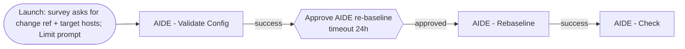

# Deploy file_integrity to AAP, from AAP (configuration as code)

This guide sets up the whole solution **inside Ansible Automation Platform
2.6**, using only the AAP web UI. You create three objects by hand (an AAP API
credential, a project and one job template). That job template then runs
[`configure_aap.yml`](configure_aap.yml), which uses the validated collection
[`infra.aap_configuration`](https://github.com/redhat-cop/infra.aap_configuration)
to create everything else as code.

**What gets created**

| Object | Name | Defined in |
|---|---|---|
| Label | `file_integrity` (applied to every object that supports labels; see below) | `vars/labels.yml` |
| Credential type | `AIDE Baseline Git Token` (secret `token` → env `AIDE_BASELINE_GIT_TOKEN`) | `vars/credential_types.yml` |
| Credential | `file_integrity baseline repo token` | `vars/credentials.yml` |
| Execution environment | `ee-supported-rhel9` (optional) | `vars/execution_environments.yml` |
| Project | `file_integrity` (this repo, update on launch) | `vars/projects.yml` |
| Job templates | `AIDE - Deploy`, `AIDE - Check`, `AIDE - Rebaseline` (survey), `AIDE - Validate Config` | `vars/job_templates.yml` |
| Job template | `AIDE - Configure AAP` (this config-as-code job; managed by itself after the first run) | `vars/job_templates.yml` |
| Workflow | `AIDE - Change Rebaseline`: Validate Config → **Approval** → Rebaseline → Check | `vars/workflows.yml` |
| Schedule | `AIDE - Daily Check`: AIDE - Check every day at 03:00 America/Los_Angeles | `vars/schedules.yml` |

**Labels.** Every object that AAP allows to carry a label gets the
`file_integrity` label (`aap_fim_label`): the 5 job templates, the workflow
and the schedule. In the AAP UI, filter **Templates** (or **Jobs**) by
*Label = file_integrity* to see everything belonging to this solution.
Credential types, credentials, projects and execution environments cannot
have labels in AAP; they are identifiable by their names and descriptions.
`AIDE - Check` prompts for labels on launch (pre-filled with
`file_integrity`), because AAP requires that for a schedule to carry a label.

Checks are scheduled **only** by AAP. No cron jobs are created on your hosts,
and any existing AIDE cron entry is removed.

> Menu names below are from the AAP 2.6 UI. In the left navigation,
> **Automation Execution** holds Templates, Projects and Infrastructure
> (Inventories, Credentials, Execution Environments), and **Access Management**
> holds Organizations.

---

## Before you start: checklist

You need an AAP user with **System Administrator** rights (or Organization
Admin for the target organization) and the following:

| # | Item | Notes |
|---|---|---|
| 1 | An **organization** | e.g. `Default` |
| 2 | An **inventory** with your RHEL 8/9/10 hosts in a group named **`aide`** | Or another group; see `aap_fim_target_hosts` in step 4 |
| 3 | A **Machine credential** that can SSH to those hosts and `sudo` to root | Its name is used in step 4 |
| 4 | A **private Git repository for baselines** with at least one commit | Default: `github.com/mlowcher61/file_integrity_baselines` |
| 5 | A **token with read/write access** to that repository | GitHub fine-grained token: *Repository access* = only that repo, *Contents* = Read and write. GitLab: project access token with `write_repository`. |
| 6 | Your Red Hat **Automation Hub token** | From <https://console.redhat.com/ansible/automation-hub/token>. Needed so AAP can install certified and validated collections. |

---

## Step 1: Let your organization download certified and validated collections

When AAP syncs the project, it installs `collections/requirements.yml`
(`redhat.rhel_system_roles`, `ansible.posix`, `community.general`,
`infra.aap_configuration`, `ansible.platform`, `ansible.controller`).
That requires Automation Hub access on the organization.

1. Go to **Automation Execution → Infrastructure → Credentials → Create credential**.
   Create **two** credentials of type **Ansible Galaxy/Automation Hub API Token**:

   | Field | Credential 1 | Credential 2 |
   |---|---|---|
   | Name | `Automation Hub - published` | `Automation Hub - validated` |
   | Organization | your organization | your organization |
   | Galaxy Server URL | `https://console.redhat.com/api/automation-hub/content/published/` | `https://console.redhat.com/api/automation-hub/content/validated/` |
   | Auth Server URL | `https://sso.redhat.com/auth/realms/redhat-external/protocol/openid-connect/token` | same |
   | API Token | your Automation Hub token | same |

2. Go to **Access Management → Organizations →** *your organization* **→ Edit**.
3. Under **Galaxy credentials**, select in this order:
   `Automation Hub - published`, `Automation Hub - validated`, `Ansible Galaxy`.
4. Click **Save**.

*Skip this step if your organization already lists Automation Hub
credentials, or a private automation hub that mirrors these collections.*

## Step 2: Create a credential AAP can use to configure itself

1. Go to **Automation Execution → Infrastructure → Credentials → Create credential**.
2. Fill in:

   | Field | Value |
   |---|---|
   | Name | `AAP config as code` (any name; you enter it again in step 4) |
   | Organization | your organization |
   | Credential type | **Red Hat Ansible Automation Platform** |
   | Red Hat Ansible Automation Platform | your platform URL, e.g. `https://aap.example.com` |
   | Username / Password | an admin user, **or** leave blank and use OAuth Token |
   | OAuth Token | (alternative to username/password) a token for an admin user |
   | Verify SSL | checked (uncheck only for labs with self-signed certificates) |

3. Click **Create credential**.

## Step 3: Create the project

1. Go to **Automation Execution → Projects → Create project**.
2. Fill in:

   | Field | Value |
   |---|---|
   | Name | **`file_integrity`** (use exactly this name; the configuration adopts it) |
   | Organization | your organization |
   | Execution environment | `Default execution environment` |
   | Source control type | **Git** |
   | Source control URL | `https://github.com/mlowcher61/file_integrity.git` (or your fork) |
   | Source control branch | `main` |
   | Options | ✅ Clean, ✅ Update revision on launch |

3. Click **Create project** and wait until the sync status is **Successful**.
   If it fails while installing collections, recheck step 1.

## Step 4: Create the "AIDE - Configure AAP" job template

1. Go to **Automation Execution → Templates → Create template → Create job template**.
2. Fill in:

   | Field | Value |
   |---|---|
   | Name | **`AIDE - Configure AAP`** (use exactly this name) |
   | Job type | Run |
   | Inventory | **`Demo Inventory`** (it contains `localhost`; any inventory with `localhost` works) |
   | Project | `file_integrity` |
   | Playbook | **`aap/configure_aap.yml`** |
   | Execution environment | `Default execution environment` |
   | Credentials | the **Red Hat Ansible Automation Platform** credential from step 2 |

3. In **Extra variables**, paste the following and replace the four values
   with **names of objects that already exist** in your AAP:

   ```yaml
   ---
   aap_fim_organization: Default                    # your organization
   aap_fim_inventory: RHEL Servers                  # inventory with the "aide" group
   aap_fim_machine_credential: RHEL SSH             # Machine credential (SSH + sudo)
   aap_fim_aap_credential: AAP config as code       # credential from step 2
   ```

   Optional overrides go in the same box, for example:

   ```yaml
   aap_fim_target_hosts: rhel_servers               # if your group is not "aide"
   aap_fim_baseline_repo_url: https://github.com/acme/aide-baselines.git
   aap_fim_project_url: https://github.com/acme/file_integrity.git   # your fork
   aap_fim_create_execution_environment: false      # if ee-supported-rhel9 already exists
   aap_fim_config_inventory: Demo Inventory         # inventory used by this job template
   aap_fim_label: file_integrity                    # label applied to templates, workflow, schedule
   ```

   The full list, with defaults, is in [`vars/00_site.yml`](vars/00_site.yml).

4. Click **Create job template**.
5. On the new template, open the **Survey** tab → **Create survey question**:

   | Field | Value |
   |---|---|
   | Question | `Baseline repository token` |
   | Answer variable name | **`aap_fim_baseline_token`** |
   | Answer type | **Password** |
   | Required | unchecked |

   Click **Create survey question**, then turn the survey **on**
   (the *Survey enabled* toggle).

   Password answers are encrypted by AAP and hidden in job output.

## Step 5: Run it

1. On **AIDE - Configure AAP**, click **Launch**.
2. In the survey, paste the **baseline repository token** (checklist item 5).
3. Click **Next → Finish** and watch the job output. The first task lists
   any setting you forgot. Then `infra.aap_configuration` creates, in order:
   the credential type, the credential, the execution environment, the project
   (updating the one from step 3), the job templates, the workflow and the
   schedule.
4. The job should end with `failed=0`.

**Check the result:**

- **Templates** lists `AIDE - Deploy`, `AIDE - Check`, `AIDE - Rebaseline`,
  `AIDE - Validate Config`, `AIDE - Change Rebaseline` (workflow) and
  `AIDE - Configure AAP`.
- **AIDE - Check → Schedules** shows `AIDE - Daily Check`.
- **Credentials** lists `file_integrity baseline repo token`.
- **AIDE - Configure AAP** now uses the `ee-supported-rhel9` execution
  environment, and its extra variables and survey are managed by the code.

## Step 6: Deploy AIDE to your hosts

1. Launch **AIDE - Validate Config**. On hosts that do not have AIDE yet,
   this fails with "AIDE is not installed". That is expected before the
   first deploy.
2. Launch **AIDE - Deploy**. Optionally enter a **Limit** (e.g. one or two
   hosts) for a pilot. Each host reports `new baseline published`, and the
   job prints the baseline repository commit.
3. Launch **AIDE - Check**. Every host should be **CLEAN**.
4. Done. **AIDE - Check** now runs every day at 03:00 America/Los_Angeles.
   Add a notification (Templates → AIDE - Check → *Notifications*) for
   **Failure** to be alerted about detected changes.

Day-to-day procedures (triage, approved rebaselines, adding hosts, recovery)
are in [docs/OPERATIONS.md](../docs/OPERATIONS.md).

---

## Making changes later

Everything except the bootstrap credential is code. To change something:

| You want to... | Do this |
|---|---|
| Change a site setting (org, inventory, target group, baseline repo URL) | Edit the **extra variables** of `AIDE - Configure AAP`, then launch it. The job writes every `aap_fim_*` setting back into its own template, so your values persist (after the first run the box lists them all, with their current values). |
| Change job templates, workflow, schedule, etc. | Edit `aap/vars/*.yml` in your fork, push, then launch `AIDE - Configure AAP` (the project updates on launch). |
| **Rotate the baseline repository token** | Launch `AIDE - Configure AAP` and enter the new token in the survey. |
| Re-apply the configuration (e.g. after someone changed a template in the UI) | Launch `AIDE - Configure AAP` and leave the survey blank. The existing token is kept. |
| Change the watch list | Not here. Set `aide_*` variables on your inventory or groups; see [docs/WATCHLIST.md](../docs/WATCHLIST.md). |

**Tip:** to make AAP re-apply the configuration automatically whenever the
repository changes, add a webhook or a schedule to `AIDE - Configure AAP`.

## How the workflow works



The workflow survey collects `aide_change_ref` and `aide_target_hosts`.
Workflow variables and the Limit are passed to every node. Approvers find
pending requests under **Automation Execution → Workflow Approvals**. The
approval expires after `aap_fim_approval_timeout` seconds (default 86400).

## Troubleshooting

| Symptom | Cause | Fix |
|---|---|---|
| Project sync fails: `Failed to find ... redhat.rhel_system_roles` or `infra.aap_configuration` | The organization cannot reach Automation Hub | Step 1: add the Automation Hub credentials to the organization's **Galaxy credentials**, then sync again. |
| `These settings still hold placeholder values: ...` | Missing extra variables | Step 4.3. |
| `... was not found` from *Confirm the existing AAP objects named in the site settings exist* | An extra variable names an object that does not exist (names are case-sensitive), or the AAP credential's user cannot see it | Correct the name in the job template's extra variables, or grant the user access. |
| `No AAP connection details were found` | The AAP credential is not attached | Attach the **Red Hat Ansible Automation Platform** credential (step 2) to `AIDE - Configure AAP`. |
| `could not find credential ... file_integrity baseline repo token` on the first run | The survey token was left blank on the first run | Launch again and enter the token. |
| `Could not find execution environment ee-supported-rhel9` | `aap_fim_create_execution_environment: false` but no EE with that name exists | Set it to `true`, or set `aap_fim_execution_environment` to the name of an existing EE that contains `redhat.rhel_system_roles`. |
| EE image pull fails | Registry credential name differs | Set `aap_fim_execution_environment_registry_credential` to your registry credential's name. |
| HTTP 401/403 from the API | The AAP credential user lacks rights | Use a System Administrator, or an Organization Admin of the target organization. |
| SSL errors | Self-signed certificates | Uncheck *Verify SSL* on the AAP credential (labs only). |
